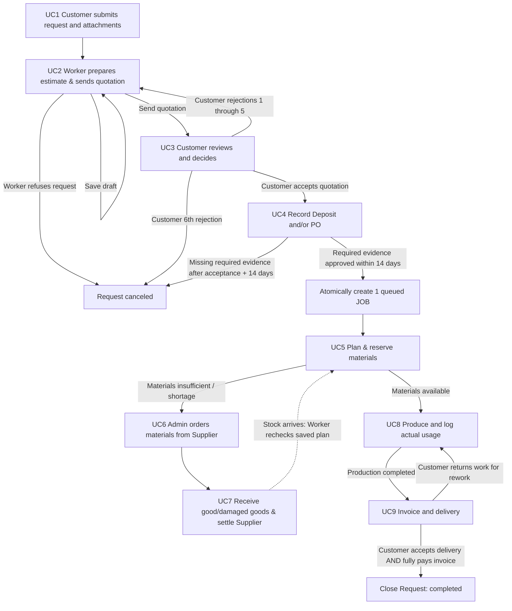

# Machine Shop Custom Manufacturing System — Architecture & Requirements

## 1. System Summary and Scope

The system integrates customer requests, estimation and quotations, production jobs, purchasing and receiving of raw materials, inventory management, delivery, and payments into a unified, traceable backend workflow. It addresses the lack of job and payment tracking and unreliable stock visibility in a made-to-order machine shop environment.

The shop is operated by an unincorporated owner and does not charge VAT. All transactions and accounting throughout the system operate strictly without VAT.

### Core Actors and Permissions

| Actor / Role | Responsibilities | Key Use Cases |
|---|---|---|
| **Customer** (`individual` or `company`) | Self-register, join companies via invitation, submit job requests and drawings, accept/reject quotations, submit deposit/PO evidence, inspect delivered goods, submit payment proof | UC1, UC3, UC4, UC9 |
| **Worker** (Technician) | Estimate costs and draft/send quotations, manage queued-job material plans, receive goods and report defect claims, operate and log production (usage, labor minutes, photos), issue invoices and record shipments | UC2, UC5, UC7, UC8, UC9 |
| **Admin** (Shop Manager / Owner) | Bootstrap first account, manage worker accounts and passwords, manage unit/material catalog and stock counts, manage supplier catalog and orders, set credit terms, approve payments, record cash transactions, enter actual labor costs | Auth, UC5, UC6, UC7, UC8, UC9 |
| **Supplier** | External actor (no system login); delivers raw materials and replacement goods, accepts/rejects purchase orders externally | UC6, UC7 |

---

## 2. End-to-End Workflow (UC1–UC9)

---

## 3. Technology Architecture & Conventions

| Architectural Area | Standard & Decisions |
|---|---|
| **Language & Framework** | Go (1.25+), standard `net/http`, routing with `github.com/go-chi/chi/v5` and `chi/cors`. |
| **Layered Structure** | Handler → Service → Repository → PostgreSQL. Handlers parse/validate and write JSON. Services enforce business invariants. Only repositories execute SQL or import database drivers. |
| **Database** | PostgreSQL 17 with `jackc/pgx/v5` connection pooling. All tables use UUID primary keys. |
| **Data Types & Arithmetic** | Monetary values use `NUMERIC(18,2)` THB strings. Material quantities and per-unit costs use `NUMERIC(18,6)`. Floating-point numbers are strictly forbidden. Time instants use `timestamptz` with `Asia/Bangkok` business display. |
| **Object Storage** | S3-compatible private object storage (SeaweedFS locally). Stores private object keys and metadata in DB only; client downloads/uploads use short-lived signed URLs. Evidence is never public. |
| **Asynchronous Processing** | Transactional outbox table (`outbox_event`) and separate background worker process (`cmd/worker`) with `FOR UPDATE SKIP LOCKED` polling. No Redis or message broker. |
| **Notifications** | Per-user in-system inbox. External LINE Messaging alerts target only the single configured Admin user ID. |

---

## 4. Entity Statuses and Lifecycle Transitions

| Entity | Statuses | Allowed Transitions & Rules |
|---|---|---|
| `JOB_REQUEST` | `pending`, `ongoing`, `completed`, `canceled` | Created as `pending` (UC1); becomes `ongoing` when first quotation is sent (UC2); becomes `canceled` on Worker refusal (UC2), 6th customer rejection (UC3), or missing evidence deadline expiry (UC4); becomes `completed` only when delivery is accepted AND invoice is fully paid (UC9). |
| `QUOTATION` | `draft`, `sent`, `approved`, `rejected` | Created as `draft` (UC2); becomes `sent` upon dispatch (UC2); becomes `approved` on customer acceptance (UC3); becomes `rejected` on customer rejection (UC3). A rejected quotation allows Worker to create the next revision version. |
| `JOB` | `queued`, `in_progress`, `completed`, `cancelled` | Created as `queued` upon final UC4 evidence approval; becomes `in_progress` when Worker starts production with fully reserved plan (UC8); becomes `completed` on Worker completion (UC8); returns to `in_progress` if customer returns shipment for rework (UC9). |
| `MATERIAL_RESERVATION` | `reserved`, `consumed`, `released` | Created as `reserved` while queued (UC5); becomes `consumed` when material is actually issued in production (UC8); becomes `released` when unconsumed leftovers are freed upon completion or plan reduction. |
| `MATERIAL_ORDER` | `ordered`, `partially_received`, `received`, `cancelled` | Created as `ordered` / `pending` (UC6); becomes `partially_received` on partial delivery (UC7); becomes `received` when all lines are fully good (UC7); becomes `cancelled` on supplier rejection or pre-receipt Admin cancellation (UC6). |
| `MATERIAL_DEFECT_LOG` | `PENDING_CLAIM`, `CLAIMED`, `RESOLVED` | Created as `PENDING_CLAIM` on receiving damaged goods (UC7); becomes `CLAIMED` when staff records external claim; becomes `RESOLVED` automatically when good replacement items arrive. |
| `DELIVERY` | `shipping`, `delivered`, `returned` | Created as `shipping` when staff dispatches completed job (UC9); becomes `delivered` on customer acceptance; becomes `returned` on customer return for rework. |
| `INVOICE` | `unpaid`, `partial`, `paid` | Created as `unpaid` (UC9); becomes `partial` when approved payment allocations remain below total; becomes `paid` once fully allocated. |
| `MATERIAL_ORDER.payment_status` | `unpaid`, `pending`, `paid` | Created as `unpaid` (UC6); becomes `pending` when credit days are set and goods are fully received (UC7); becomes `paid` upon single full settlement (UC7). |
| `ACCOUNT.is_active` | `true`, `false` | Managed by Admin. Inactive accounts are blocked immediately from authenticated actions. |

---

## 5. Confirmed Business Policies Across UC1–UC9

1. **Pricing Formula (UC2)**: Minimum quotation price = `(material_cost + labor_cost) * 1.60` (60% markup on total cost). Applies to the whole requested quantity. Quoted final price may exceed minimum, never fall below it. Rounded upward to the nearest satang. No VAT.
2. **Quotation Decisions & Cancellation (UC3)**: Customer rejections 1 through 5 permit Worker to submit revisions. The 6th distinct customer rejection across all revisions atomically cancels the request. Any active company member may accept or reject quotations on behalf of the company.
3. **Acceptance Terms & Thresholds (UC3, UC4)**:
   - `individual`: 50% deposit (rounded upward to satang), no PO.
   - `company` with total <= THB 10,000.00: PO required, no deposit.
   - `company` with total > THB 10,000.00: PO required AND 50% deposit.
4. **Deposit & Evidence Submission Deadline (UC3, UC4)**: Documents due instant is quotation acceptance time + 14 days (336 hours). Submitting complete evidence within 14 days protects it; staff may review it later. Missing or rejected required evidence after 14 days causes automatic cancellation by the background scanner.
5. **Job Cardinality (UC4)**: Exactly one queued job opens atomically after all required UC4 evidence is approved. Overrides the older ER's one-to-many relationship.
6. **Stock Requirements, Reservations, and Consumption (UC5, UC8)**:
   - *Requirements*: Desired material quantities planned per queued job.
   - *Reservations*: Active stock reserved for a job. Does not decrease physical on-hand quantity.
   - *Shortage*: `required - reserved`. Never hidden by partial allocations.
   - *Consumption*: Decreases physical on-hand quantity only when actual usage is logged in UC8.
7. **Weighted-Average Costing (UC5, UC7)**: Recalculated only upon new stock additions or good supplier receipts:
   $$\text{New Average} = \frac{(\text{Old On-Hand} \times \text{Old Avg}) + (\text{Added Qty} \times \text{Unit Cost})}{\text{Old On-Hand} + \text{Added Qty}}$$
   Rounded half-up to 6 decimal places. Count corrections preserve current average cost and cannot reduce on-hand below active reservations.
8. **Supplier Orders & Procurement (UC6, UC7)**: Admin-only. One supplier per order, flexible zero/many job references. Orders may consolidate jobs, exceed shortages, or replenish general stock. Placed quantities and prices are immutable. Replacement-only defect resolution; no refunds or write-offs. Credit period starts from full good receipt. Exactly one full payment settlement after full good receipt.
9. **Production Logging & Labor Costs (UC8)**: Any active Worker may start, log incremental usage, enter whole labor minutes, and complete jobs. Actual use consumes own reservation first, then free stock. Completion releases all unused reservations without adding physical stock. Admin enters actual labor cost (no assumed rate).
10. **Delivery, Invoicing, Free Rework & Closure (UC9)**:
    - One invoice per job for `price - actual approved deposit`.
    - Installments permitted; positive payments up to remaining balance; Admin approves bank proof.
    - Whole-job delivery. Customer inspects and accepts or returns for free rework.
    - Pre-acceptance return reopens the same job for free rework; previous usage and invoices are preserved; redelivery requires completing rework.
    - Request closure requires BOTH accepted delivery and fully paid invoice.
