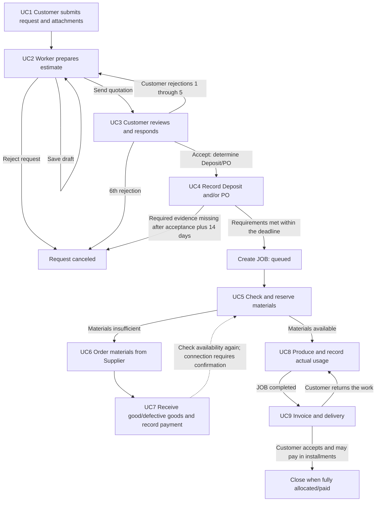

# Machine Shop Custom Manufacturing System — Backend Guide

> Owner-confirmed implementation clarifications (2026-10-15): customers
> self-register; company users join by invitation and share company requests.
> Cancel on the sixth rejection, not the fifth. Deposit/PO deadline is 14 days
> after quotation acceptance. Store private object keys and metadata, not public
> URLs. Uploads: PDF, DOC/DOCX, XLS/XLSX, TXT, JPEG/PNG, maximum 100 MB. LINE alerts
> target only the configured Admin user; inbox notifications are per-user.
> These decisions override conflicting older assumptions below. See UC1.md
> for implemented auth, storage, folder boundaries and API contracts.

> Frontend/backend alignment: the owner reconfirmed cancellation on the sixth
> distinct customer quotation rejection. Admin Worker management requires name,
> email and phone, while retaining existing username/password/employee_no fields
> and optional position. Admin can add/edit, deactivate/reactivate and change
> Worker passwords. Required email/phone API, validation and persistence are
> implemented in migration 000006; see AUTH.md for syntax and legacy handling.

> UC4 owner confirmations (2026-10-18): both Admin/Worker review private evidence;
> one deposit may cover the rounded 50% minimum through 100%; timely complete
> submissions may be reviewed later; missing evidence expires; exactly one job
> opens after all required approvals. These override the old ER's one-to-many
> job relationship. See UC4.md for implemented API, retry and deadline semantics.

> UC5 owner confirmations (2026-10-18): Workers save/edit queued-job material plans
> and reserve available stock with explicit shortages. Admin manages catalog and
> audited stock additions/corrections. Reductions release excess; production locks
> plan edits. Additions recalculate weighted-average cost; count corrections retain
> cost and cannot reduce stock below reservations. NUMERIC(18,6), base units only.
> See UC5.md; this resolves the older planning/master-data questions below.

## Project summary

> UC7 owner confirmations (2026-10-19) override older receiving/payment assumptions:
> Admin and Worker receive/manage replacement-only claims. Supplier prices, stock
> costs, credit/payment details and payment evidence are Admin-only. Accepted orders,
> partial receipts/no excess. Damaged quantities stay outstanding until replaced by
> good units. Admin-entered credit days start at full good receipt; one full bank/
> cash settlement afterwards. Bank evidence required; cash photo/proof optional.
> No default credit days, refund/write-off, auto-reservation or supplier notification.
> Implementation is in progress; see UC7.md and UC7_VERIFICATION.md for actual status.

> UC6 owner confirmations (2026-10-18): only Admin manages suppliers and supplier
> orders, including reads, responses and cancellation. Option A: zero/many flexible
> job references, no fixed allocation or shortage cap; over-ordering is allowed.
> Worker plan edits remain independent. Immutable placed quantities/prices;
> cancel/recreate unreceived commitments. Supplier rejection cancels with reason.
> Round each line half-up to two decimals, then sum. No stock/average-cost changes
> until UC7 receiving. This overrides the Worker/single-job/shortage-only assumptions
> below; see UC6.md for implemented API, states and retry/audit semantics.

The system brings customer requests, quotations, production jobs, purchasing/receiving materials, inventory, delivery, and payments into one workflow. It addresses the current lack of job/payment tracking and reliable stock information. The business is not registered as a company and does not charge VAT, as confirmed by the owner.

| Actor / role | Responsibilities in the workflow | Use cases |
|---|---|---|
| Customer (`individual` or `company`) | Submit requests and files, accept/reject quotations, submit Deposit or PO evidence, inspect delivered work, and pay | UC1, UC3, UC4, UC9 |
| Worker (technician) | Estimate prices, check/reserve stock, produce work; later receiving/delivery permissions require their phase's confirmation | UC2, UC5; UC7–UC9 pending |
| Admin | Manage Workers, suppliers and supplier orders; procurement is Admin-only | UC6 |
| Supplier | Accept/reject orders, deliver materials, and receive payment; an external actor | UC6, UC7 |

### UC1–UC9 workflow

The sequence and handoffs above come from the Use Cases, Sequence Diagrams, and Collaboration Diagrams summarized in the overview. The UC7-to-UC5 return is a temporary proposal; the source did not clearly specify this handoff.

### Glossary: entities managed by Backend

| Entity / term | Meaning |
|---|---|
| `JOB_REQUEST` | A customer's manufacturing request before it becomes a production job |
| `QUOTATION` | A quotation that may have multiple revisions |
| `QUOTATION_COST` | Material cost, labor cost, and final price for a quotation |
| `DEPOSIT` | Customer deposit based on customer type and quoted amount |
| `PURCHASE_ORDER` (PO) | A PO from a company customer to confirm production |
| `JOB` | A production job opened after quotation terms are confirmed |
| `MATERIAL_RESERVATION` | Material quantity reserved for a job |
| `MATERIAL_ORDER`, `MATERIAL_ORDER_ITEM` | A material order from a Supplier and its line items |
| `STOCK_MOVEMENT` | History of material receipts, issues, adjustments, or returns |
| `MATERIAL_DEFECT_LOG` | Defective-material history and Supplier claim status |
| `DELIVERY` | Delivery or customer pickup, including recipient and evidence |
| `INVOICE` | Customer invoice; its initial amount is the job price less Deposit |
| `PAYMENT`, `PAYMENT_ALLOCATION` | Payment receipt and the amount allocated to an invoice; multiple payments are supported |
| `MATERIAL` | Material; `avg_cost` uses Moving Average based on good stock received, excluding defective goods |

## Technology scope and architecture

| Area | Requirement |
|---|---|
| Backend | Go + chi |
| Database | PostgreSQL |
| File storage | S3-compatible object storage; store URLs in the database |
| Authentication | Customer, Admin, and Worker accounts; login is required before every use case |
| Background work | Outbox + worker |
| Local development | Docker Compose |
| IDs / time | UUID; display timezone is `Asia/Bangkok` |
| Data types | `timestamptz` is proposed for time and `NUMERIC` for money; precision/rounding still needs confirmation |

Request path: `Handler → Service → Repository → PostgreSQL`. Keep Handlers thin; Repository is the only layer that communicates with PostgreSQL. **The concrete folder layout must be defined** because the overview specifies layers but not directory/file names. Preserve these layer boundaries when agreeing on the layout.

The authentication boundary must verify that the user is logged in and has the role required for the action. Do not assume Supplier is a system account: Supplier is currently an external actor. The provider, account table, credential/session design, password reset flow, and account linkage to `PERSON` are not defined.

## Statuses and transitions

The values below preserve those found in the ER/Use Cases. Do not infer transitions that are absent or inconsistent in the source.

| Entity | Statuses found / proposal | Workflow transitions |
|---|---|---|
| `JOB_REQUEST` | `pending`, `ongoing`, `completed`, `canceled` | Created as `pending`; becomes `ongoing` when a quotation is sent; becomes `canceled` if rejected or expired; transition to `completed` is not specified |
| `QUOTATION` | `draft`, `sent`, `approved`, `rejected`; ER also has `requote`, but no transition uses it | `draft` → `sent` when sent → `approved` when accepted; rejection sets `rejected` and enables a new draft revision after rejections 1–5; the sixth distinct customer rejection cancels the request |
| `JOB` | `queued`, `in_progress`, `completed`, `cancelled` | Created as `queued`; production starts as `in_progress`; production completion sets `completed`; customer return changes it back to `in_progress` |
| `MATERIAL_RESERVATION` | `reserved`, `consumed`, `released` | Reservation sets `reserved`; issuing material sets `consumed`; `released` exists in the ER but has no workflow transition |
| `MATERIAL_ORDER` | `ordered`, `partially_received`, `received`, `cancelled` | Created as `ordered`; partial receipt sets `partially_received`; full receipt sets `received`; Supplier rejection sets `cancelled` |
| `MATERIAL_ORDER_ITEM` | ER: `ordered`, `preparing`, `in_transit`, `received`, `damaged`, `cancelled`; **proposal:** add `partially_received` to align with UC7 | Cumulative partial receipt sets `partially_received`; full receipt sets `received`; an entirely defective item may be `damaged`; `preparing`/`in_transit` transitions are absent from the workflow |
| `MATERIAL_DEFECT_LOG` | `PENDING_CLAIM`, `CLAIMED`, `RESOLVED`, `WRITTEN_OFF` | Record defect as `PENDING_CLAIM`; notify Supplier to set `CLAIMED`; transitions to `RESOLVED`/`WRITTEN_OFF` are not specified |
| `DELIVERY` | `preparing`, `shipping`, `delivered`, `returned` | UC9 creates `shipping`; customer acceptance sets `delivered`; customer return sets `returned`; `preparing` has no workflow transition |
| `INVOICE` | `unpaid`, `partial`, `paid` | Created as `unpaid`; partial allocation sets `partial`; full payment sets `paid` |
| `MATERIAL_ORDER.payment_status` | `unpaid`, `pending`, `paid` | Created as `unpaid`; `CREDIT` sets `pending`; other methods set `paid` per UC7; actual methods still need definition |
| `WORKER.status`, `ADMIN.status` | `active`, `inactive` | Enums exist in the ER; status-change rules are not specified |

Adding `partially_received` to `MATERIAL_ORDER_ITEM` is a proposal to align its enum. `JOB_REQUEST.completed`, `QUOTATION.requote`, `DELIVERY.preparing`, `MATERIAL_RESERVATION.released`, and other statuses without transitions must be defined before finalizing the API contract.

## Business rules, stock, pricing, and data integrity

| Topic | Rule / requirement |
|---|---|
| Login | Customer, Admin, and Worker must log in before using a UC; Supplier is external |
| Customer type and terms | `individual`: 50% Deposit, no PO; `company` with price ≤ THB 10,000: PO, no Deposit; `company` with price > THB 10,000: PO + 50% Deposit |
| Rejections | Count distinct Customer rejection events per request across revisions, not draft saves or users; rejections 1–5 permit a revision, and the sixth cancels the request |
| Admin Worker management | Admin adds/edits, deactivates/reactivates and changes passwords. Name/email/phone are required on create; email format is checked, international phones are allowed, and contacts are non-unique. Existing nullable contacts are preserved for Admin backfill. No deletion or role promotion; see AUTH.md |
| Customer payments | Installments are allowed; `INVOICE` is `partial` while the balance remains and `paid` when fully allocated/paid |
| Payment period | 14 days; start date and whether it applies to Deposit/PO, invoice, or both are unconfirmed |
| Pricing | `final_price` consists of material cost + labor cost + minimum 60% profit; the 60% basis is unknown, so no numeric formula is confirmed |
| Available stock | `qty_available = qty_on_hand - qty_reserved`, where `qty_reserved` represents active reservations |
| Receiving / costing | Only good materials increase `qty_on_hand` and contribute to Moving Average |
| Stock ledger | Updating `qty_on_hand` must be in the same transaction as recording `STOCK_MOVEMENT` |
| Defects | Keep defective goods separate from good stock, do not add them to good `qty_on_hand`, and record them in `MATERIAL_DEFECT_LOG` for Supplier claims |
| Files | Documents and images up to 100 MB; after upload failure, the user starts a new upload; store files in S3-compatible storage and URLs in the DB |
| IDs / time / VAT | UUID; display timezone `Asia/Bangkok`; no VAT |

### Transactions to preserve

- **UC2:** Update `JOB_REQUEST` and create `QUOTATION` and `QUOTATION_COST` in one transaction.
- **UC7:** Keep received line items, material records, `STOCK_MOVEMENT`, `MATERIAL_DEFECT_LOG`, and `MATERIAL_ORDER` status/payment consistent within a transaction.
- **UC8:** Record material usage, decrement `qty_on_hand`, record `STOCK_MOVEMENT`, and change the reservation to `consumed` in one transaction.
- **File upload:** Validate file type and size before saving the URL. Retry means starting a new upload, not automatic retry.

### Outbox and notifications

The system requires Outbox + worker. Notifications should inform the shop/customer and remind staff to follow up on collection. Notification channels, events, retry policy, recipients, and duplicate-delivery semantics **must be defined**. Do not assume a provider or event contract exists.

## UC1–UC9: triggers, flow, data, and errors

The tables/data listed are entity touchpoints from the overview. Endpoints, full field schemas, and error codes are not specified and must be defined. Every UC has a login precondition.

| UC | Trigger / steps | Related data/tables | Errors / issues to handle |
|---|---|---|---|
| UC1 Submit request | Customer submits job details and attachments; create `JOB_REQUEST` | `JOB_REQUEST`, file/URL (file stored externally; URL in DB) | Validate details and files; after upload failure, start again. Exact fields/error codes must be defined |
| UC2 Estimate price | Worker estimates; saves draft, sends quotation, or rejects request; may create revisions | `JOB_REQUEST`, `QUOTATION`, `QUOTATION_COST` | UC2 transaction required; 60% profit basis is unclear; other validation/errors must be defined |
| UC3 Respond to quotation | Customer reviews and accepts/rejects; rejections 1–5 return to UC2; sixth rejection cancels | `QUOTATION`, `JOB_REQUEST` | Make rejection counting and cancellation atomic, including concurrent actions; exact error codes must be defined |
| UC4 Record Deposit/PO | Customer submits private evidence; Admin/Worker approve/reject; open exactly one queued job after all approvals | Implemented: `term_evidence`, accepted terms, `job`, `uc4_cancellation`, private attachment references | One deposit 50-100%; acceptance plus 336h submission deadline, pending complete timely evidence protected, missing/rejected evidence expires; see UC4.md |
| UC5 Check/reserve stock | Worker saves queued-job plans, partially reserves availability and sees remaining shortages; no automatic production/order creation | Implemented: `unit`, `material`, `job_material_requirement`, `material_reservation`, immutable catalog/stock/command audits | Request/job/material row locking, stable key order, optimistic versions and same-key retries prevent double allocation. Required minus own reserved defines shortage; see UC5.md |
| UC6 Order materials | Admin only; one supplier, multiple lines and flexible many-job references; over-ordering/general replenishment allowed | supplier/audit, material_order/item/job/event, material | Confirmed option A; immutable placed lines/references; reasoned rejection/cancel, exact half-up line totals; see UC6.md |
| UC7 Receive goods and pay Supplier | Worker receives good/defective goods, updates stock/cost, records Supplier payment | `MATERIAL_ORDER`, `MATERIAL_ORDER_ITEM`, `MATERIAL`, `STOCK_MOVEMENT`, `MATERIAL_DEFECT_LOG`, payment status | Must be atomic; actual payment methods and settlement of outstanding credit are undefined; return to UC5 is a proposal |
| UC8 Produce | Worker starts/continues production, issues materials, records images and actual cost/time; customer return from UC9 resumes work | `JOB`, `MATERIAL_RESERVATION`, `MATERIAL`, `STOCK_MOVEMENT`, `JOB_MATERIAL_USAGE` (actual usage), files/URLs | UC8 transaction required; planned material data is unclear; validation/error codes must be defined |
| UC9 Deliver/receive payment | Worker delivers or arranges pickup and issues invoice; Customer inspects and may pay in installments; returned work goes back to UC8 | `DELIVERY`, `INVOICE`, `PAYMENT`, `PAYMENT_ALLOCATION`, `JOB` | Applicability of 14-day terms is unclear; invoice balance/allocation and evidence validation details/error codes must be defined |

## Open questions and temporary assumptions affecting schema or logic

| Topic | Known information | Status / question |
|---|---|---|
| 60% profit formula | Price = material + labor + minimum 60% profit | Confirm whether 60% is based on total cost or is a sales margin; no numeric formula is used yet |
| 14 days | Payment period is 14 days | Temporary assumption: applies to submitting Deposit/PO after quotation approval to support UC4 expiry; confirm start date and whether invoices are included |
| Planned materials | UC5 accepts `requiredMaterials`; ER has `JOB_MATERIAL_USAGE` for actual use but no planned list per JOB | Confirm whether Worker enters required quantities each time or a planned-material table should be added per JOB |
| Reservation/shortage | UC5: reserve available quantity and order shortage; Q6.1 calculates shortage from total reservations compared with `qty_on_hand` | Temporary proposal: calculate shortage per JOB/material and store planned quantity; review Q6.1 formula |
| Who can order | Owner resolved UC6 role on 2026-10-18 | Admin only, including supplier masters, procurement reads and recorded responses; Worker retains UC5 |
| `JOB_REQUEST.completed` | Exists in ER; no UC updates it; JOB is completed before delivery | Confirm whether the request becomes complete at delivery or after the invoice is fully paid |
| Authentication | Customer/Admin/Worker must log in; ER has no account/credential details | Define provider, account table, password/session, reset flow, and linkage to `PERSON` |
| Master data | Admin manages Workers/orders; `MATERIAL`, `UNIT`, `SUPPLIER` have no complete CRUD UC | Confirm whether Admin manages these master records |
| Supplier payment | UC7: `CREDIT` → `pending`; other methods → `paid` | Define allowed payment methods and how outstanding credit is settled |
| File types | Documents and images up to 100 MB | Define MIME/extension allowlist, signed URL lifetime, and handling of partial uploads |
| Notifications | Notify shop/customer and remind staff to follow up on collection; Outbox + worker | Define channel, event, retry policy, and recipients |
| Precision | UUID, `Asia/Bangkok`; threshold is in baht | `timestamptz` and `NUMERIC` are recommendations; confirm precision, rounding, and API time boundary |
| Status gaps | Proposed item status `partially_received`; `JOB_REQUEST.completed`, `QUOTATION.requote`, `DELIVERY.preparing`, `MATERIAL_RESERVATION.released`, and some other statuses lack transitions | Confirm before finalizing schema/API contract |
| Folder layout | Only Handler → Service → Repository → DB is specified | Define directory/file layout |

## Backend day-one checklist

- Install Go and Docker Compose; prepare the chi server, PostgreSQL connection, and migration runner.
- Set up Handler → Service → Repository, keeping Handlers thin and Repository as the only layer that communicates with PostgreSQL; agree on folder layout.
- Prepare the authentication boundary for Customer/Admin/Worker; do not choose a provider or design credentials before confirmation.
- Start migrations from the ER entities using UUIDs; apply the UC2, UC7, and UC8 transaction requirements.
- Add an S3-compatible storage adapter and Outbox/worker interface; store URLs in the DB.
- Before locking schema/API, review planned materials, pricing formula, status transitions, invoice/payment terms, roles, Supplier payment, and precision.

## Coverage from the source overview

| Section in `00-overview.md` | Location in this file |
|---|---|
| Goals and problems addressed / registration and VAT status | Project summary |
| Technology scope | Technology scope and architecture |
| Actors and workflow permissions | Project summary; Open questions |
| Glossary | Glossary: entities managed by Backend |
| Process overview and UC1–UC9 | UC1–UC9 workflow; UC1–UC9 table |
| Statuses and transitions | Statuses and transitions |
| Confirmed business rules | Business rules, stock, pricing, and data integrity |
| Transactions and data integrity | Transactions to preserve; UC1–UC9 table |
| Open questions and temporary assumptions | Open questions and temporary assumptions |
| Backend day-one checklist | Backend day-one checklist |
| Use case traceability | UC1–UC9 table |
