# System Analysis — Lathe Shop

Source: `SA Project (1).md`, supplied by the project owner on 2026-10-29. This document distills its business analysis into backend context and points to the current implemented contracts; it does not replace the UC specifications or migrations.

## System purpose

The system supports a small made-to-order lathe shop that produces custom metal work for individual and company customers. The source report identifies manual quotation preparation, weak job/deadline visibility, unreliable stock records, and difficult payment follow-up. The target is a traceable workflow joining customer requests, quotation, PO/deposit, procurement, inventory, production, delivery, invoices, and payment.

## Actors

| Actor | Backend scope |
| --- | --- |
| Customer | Own data or data shared through active company membership; requests, quotation decisions, required evidence, delivery inspection, and customer payment evidence. |
| Worker | Shop workflow actions allowed by each UC; Worker is the domain/API role and may be labelled Staff in the frontend. |
| Admin | Staff administration, catalog/stock administration, Admin-only procurement/finance functions, and authorized monitoring/review. |
| Supplier | External party referenced by procurement and replacement claims. Suppliers have no application accounts. |
| API and worker process | Validate and authorize commands, commit business state and outbox events atomically, and dispatch notifications after commit. |

## Target business process

```mermaid
flowchart LR
  A[Customer registration/request/files] --> B[Worker reviews request]
  B --> C[Worker prepares quotation]
  C --> D{Customer accepts?}
  D -->|Reject| C
  D -->|Accept| E[Submit required PO/deposit evidence]
  E --> F[Admin/Worker evidence review]
  F -->|All required approved| G[Create one queued job]
  G --> H[Maintain material plan/reservations]
  H --> I[Admin procurement if needed]
  I --> J[Admin/Worker receipt and replacement claims]
  J --> K[Worker production and actual usage]
  K --> L[Staff delivery and invoice]
  L --> M[Customer inspection and payment]
  M -->|Return before acceptance| K
  M -->|Accepted and fully paid| N[Close request]
```

The source's As-Is and To-Be process diagrams are useful analysis artifacts. The flow above is reconciled to the current UC contracts; it is not a substitute for the state/exception tables in those contracts.

## Confirmed business rules relevant across UCs

- Minimum quote = 1.60 × (material cost + labor cost) for the entire requested quantity; round upward to a satang. No VAT.
- Five quotation rejections allow another revision; the sixth distinct rejection cancels the request.
- Accepted PO/deposit terms are immutable and must be completed within 14 days (336 hours) of acceptance.
- Customer/company data access is checked on each request using the authenticated account and active membership.
- A queued job opens only after required PO/deposit submissions are approved. Exactly one job is created for the approved request.
- Stock requirement, reservation, physical receipt, and actual usage are distinct. Reservations do not consume on-hand stock; procurement orders do not change stock; production usage is separately audited.
- UC6 procurement is Admin-only. UC7 material receipt and replacement-claim work may be performed by Admin or Worker; supplier finance details remain Admin-only.
- UC8 uses explicit material use and whole labor minutes; no default assignment or labor rate. UC9 closes only when the latest delivery is accepted and the invoice is fully paid.
- Files remain private S3-compatible objects. PostgreSQL stores object key and metadata, not file bytes or public URLs; access uses authorized signed links.

See `001-UC1.md`–`009-UC9.md` for full workflows, permissions, validation, states, idempotency, and exceptions.

## Backend architecture in the current repository

- Go `net/http` + chi API and separate worker process.
- PostgreSQL via pgx, isolated in repository implementations; migrations define the actual schema.
- Handler → service → repository layering; only repositories run SQL.
- Exact monetary/quantity domains; no floating-point money.
- S3-compatible private object storage for documents/photos and PostgreSQL outbox for post-commit notification work.

The detailed architecture and setup remain in `000-requirements.md`, `000-setup.md`, and `AGENTS.md`.

## Source precedence

When the academic report differs from current behavior, use current owner-confirmed decisions, the backend UC/API contract, and migrations as the implementation source of truth. The report's schema, diagrams, SQL statements, and UI proposals are historical analysis material; they do not create endpoints, status transitions, permissions, tables, or business rules by themselves.
